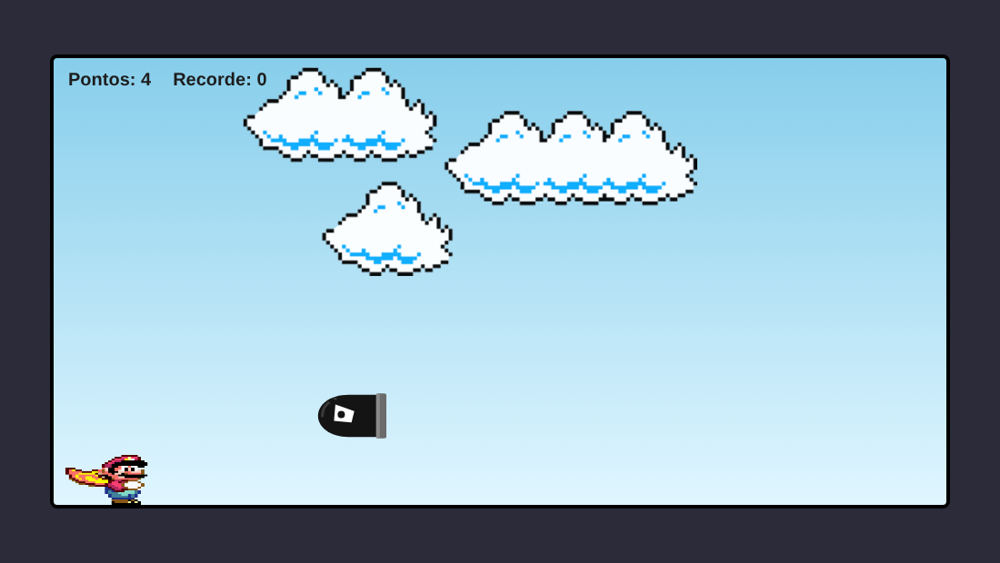
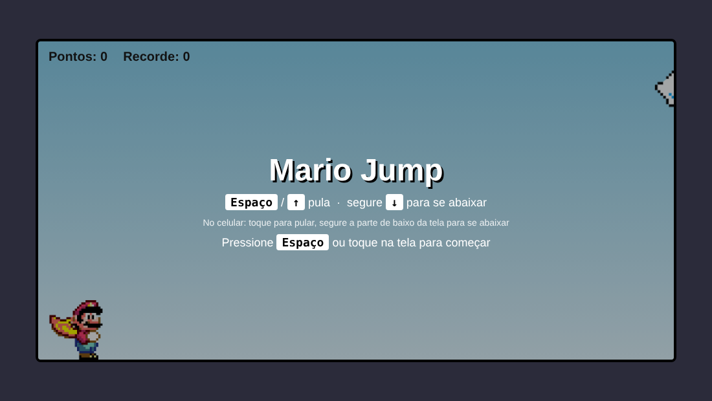
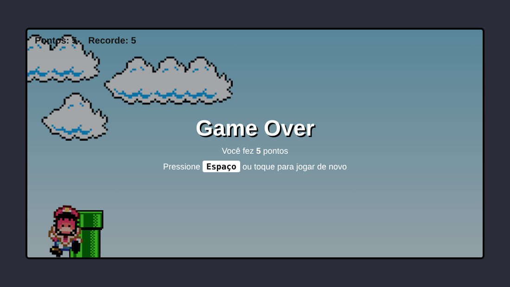

<div align="center">

# 🍄 Mario Jump

**Um jogo runner no navegador: pule os canos, abaixe nas balas e bata seu recorde!**




</div>

---

## 📖 Sobre o projeto

**Mario Jump** é um jogo de corrida infinita feito apenas com **HTML, CSS e JavaScript puro**, sem frameworks, sem bibliotecas e sem build. O Mario corre sozinho e você controla o pulo e o agachamento para desviar dos obstáculos. Quanto mais pontos, mais rápido o jogo fica.

## ✨ Funcionalidades

- 🦘 **Pulo** com subida e descida suaves
- 🧎 **Agachar** para passar por baixo dos obstáculos aéreos
- 🟢 **Canos** no chão e 💣 **balas** voando na altura da cabeça
- ⚡ **Dificuldade progressiva**: a velocidade aumenta a cada ponto, até um limite
- 🏆 **Pontuação e recorde**, com o recorde salvo no navegador (`localStorage`)
- 💀 **Tela de Game Over** com reinício instantâneo
- ☁️ **Nuvens** animadas ao fundo
- 📱 **Controles de toque** para jogar no celular
- 🔍 **Colisão com hitbox ajustada**, mais justa que a imagem inteira

## 🎮 Controles

| Ação | Teclado | Celular |
| --- | --- | --- |
| Começar / reiniciar | `Espaço` ou `↑` | Toque na tela |
| Pular | `Espaço`, `↑` ou `W` | Toque na tela |
| Abaixar | Segure `↓` ou `S` | Segure o dedo na parte de baixo da tela |

> 💡 **Dica:** as balas voam na altura da cabeça. Abaixe-se para passar por baixo (ou pule bem alto).

## 🖼️ Capturas de tela

<div align="center">

| Tela inicial | Game Over |
| :---: | :---: |
|  |  |

</div>

## 🚀 Como executar

Não precisa instalar nada.

1. Baixe ou clone este projeto.
2. Abra o arquivo **`index.html`** em qualquer navegador moderno (Chrome, Edge, Firefox, Safari).
3. Pressione `Espaço` e jogue!

Se preferir rodar com um servidor local (opcional):

```bash
# com Python
python -m http.server 8000

# ou com Node
npx serve .
```

Depois acesse `http://localhost:8000`.

## 📁 Estrutura

```text
Mario/
├── index.html          # estrutura da página e elementos do jogo
├── css/
│   └── style.css       # visual, animações de pulo e nuvens
├── js/
│   └── script.js       # lógica: movimento, colisão, pontuação, controles
├── imagens/
│   ├── mario.gif       # Mario correndo
│   ├── game-over.png   # Mario derrotado
│   ├── pipe.png        # cano
│   ├── bala.svg        # bala voadora
│   └── clouds.png      # nuvens
└── docs/               # capturas de tela usadas neste README
```

## ⚙️ Como funciona

- **Pulo e nuvens** são animações CSS (`@keyframes jump` e `@keyframes clouds-animation`).
- **Obstáculos** são movidos pelo JavaScript com `requestAnimationFrame`, usando o tempo entre quadros para manter a velocidade estável em qualquer monitor.
- **Colisão** compara a caixa do Mario (que muda de altura quando ele está abaixado) com a caixa do obstáculo atual a cada quadro.
- **Pontos**: cada obstáculo que passa pelo Mario vale 1 ponto e deixa o jogo um pouco mais rápido.

## 🛠️ Personalização

As configurações ficam no topo do `js/script.js`:

| Constante | O que faz |
| --- | --- |
| `START_SPEED` | Velocidade inicial (larguras da tela por segundo) |
| `MAX_SPEED` | Velocidade máxima |
| `SPEED_STEP` | Quanto a velocidade aumenta a cada ponto |
| `BULLET_FROM` | Pontuação mínima para as balas começarem a aparecer |
| `BULLET_CHANCE` | Chance (de 0 a 1) de o próximo obstáculo ser uma bala |

E no `css/style.css`:

- **Duração do pulo:** altere `animation: jump 600ms linear` na classe `.mario.jump`.
- **Altura do pulo:** altere o valor `bottom: 170px` nos `@keyframes jump`.
- **Altura da bala:** altere `bottom: 70px` na classe `.bullet`.

## 🗺️ Ideias para o futuro

- [ ] Efeitos sonoros (pulo, colisão, pontuação)
- [ ] Botão de pausa
- [ ] Chão de tijolos animado
- [ ] Novos inimigos e itens
- [ ] Modo noite

## 🙌 Créditos

Projeto de estudo de **HTML, CSS e JavaScript**. Os sprites do Mario e do cano são de propriedade de seus respectivos donos e foram usados apenas para fins educacionais. A imagem da bala (`bala.svg`) foi criada para este projeto.

<div align="center">


</div>
